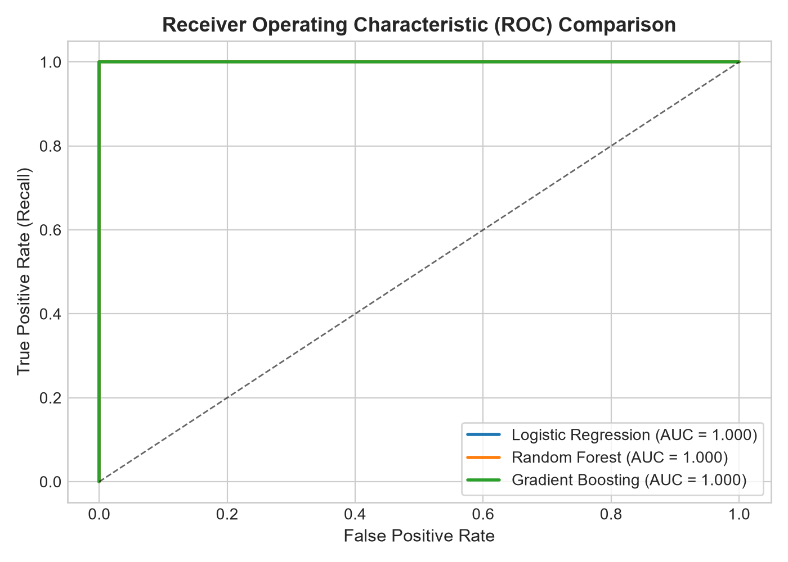
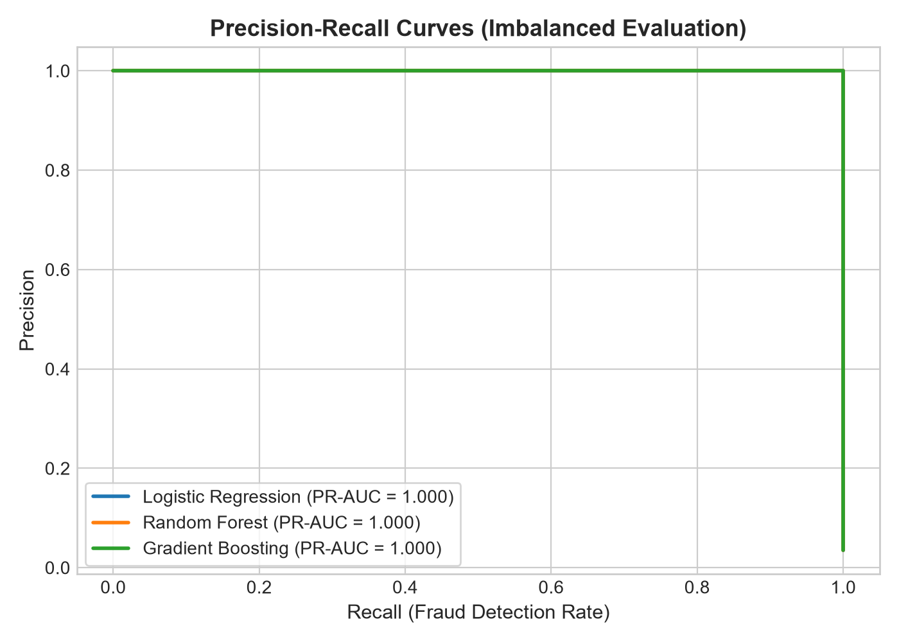
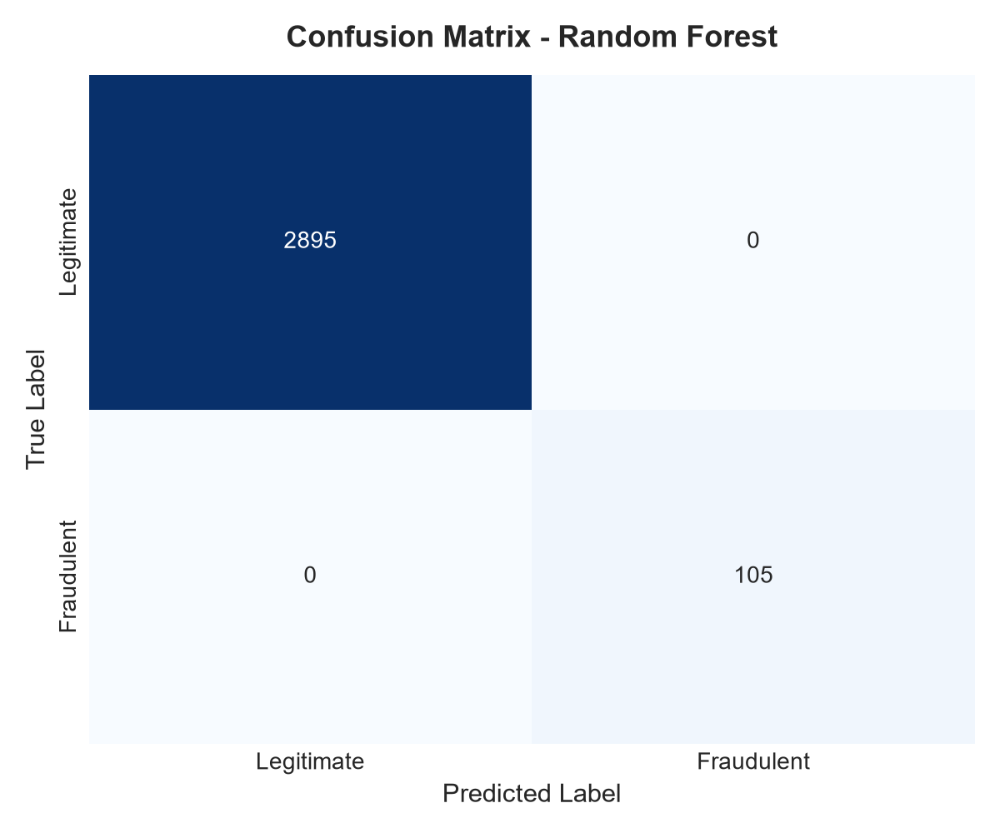
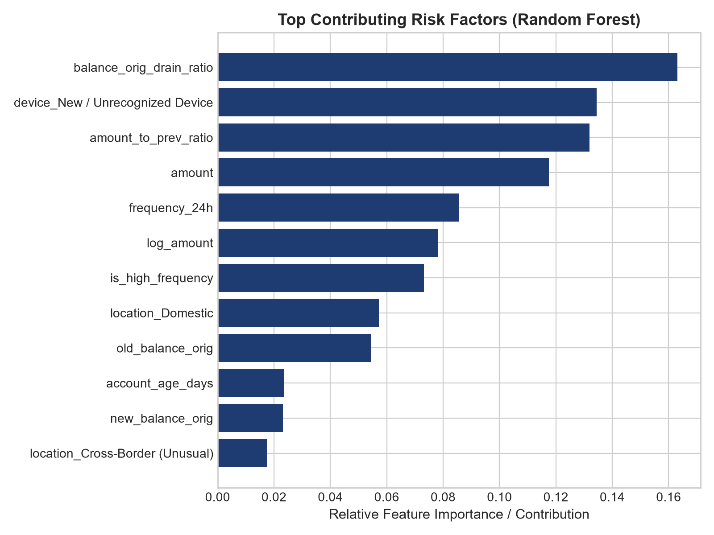

# FraudGuard -AI

### Financial Transaction Fraud Detection & Risk Analysis Web Application

[](https://www.python.org/)
[](https://palletsprojects.com/p/flask/)
[](https://scikit-learn.org/)
[](https://www.postgresql.org/)
[](https://redis.io/)
[-brightgreen.svg)](https://pytest.org/)
[](https://www.docker.com/)
[](LICENSE)

**FraudGuard -AI** is a full-stack web application built with **Python**, **Flask**, **SQLAlchemy**, and **Scikit-learn** to detect fraudulent financial transactions. Developed as a final-year Computer Science and Engineering capstone project, it evaluates transactions in real time, calculates fraud probabilities ($0.0\% - 100.0\%$), assigns risk levels, explains key risk factors, and creates incident alerts for analysts.

The application connects all user-facing features—including real-time prediction, batch CSV uploads, visual analytics charts, and administrative audit logs—directly to a relational database and a pre-trained Random Forest model (`pipeline.joblib`).

---

## Table of Contents

1. [Project Overview](#1-project-overview)
2. [Problem Statement & Proposed Solution](#2-problem-statement--proposed-solution)
3. [Key Features](#3-key-features)
4. [Machine Learning Diagnostics & Visualizations](#4-machine-learning-diagnostics--visualizations)
5. [Technology Stack](#5-technology-stack)
6. [System Architecture](#6-system-architecture)
7. [Machine Learning Pipeline & Methodology](#7-machine-learning-pipeline--methodology)
8. [Project Structure](#8-project-structure)
9. [Installation & Local Setup](#9-installation--local-setup)
10. [Environment Variable Configuration](#10-environment-variable-configuration)
11. [Automated Testing & Verified Results](#11-automated-testing--verified-results)
12. [Security Architecture & Defensive Controls](#12-security-architecture--defensive-controls)
13. [Production Deployment (Render, Neon & Upstash)](#13-production-deployment-render-neon--upstash)
14. [Demonstration Access & Recruiter Portal](#14-demonstration-access--recruiter-portal)
15. [Planned Future Improvements](#15-planned-future-improvements)
16. [License & Educational Disclaimer](#16-license--educational-disclaimer)

---

## 1. Project Overview

FraudGuard -AI connects machine learning model inference with a functional web interface. Instead of running only in a Jupyter notebook, the model is served by a Flask application that provides both web views and REST API endpoints.

Key capabilities include:
- **Real-Time Transaction Scoring**: Analyzes transaction details entered via a web form or submitted through the REST API.
- **Risk Factor Explanations**: Highlights the specific transaction attributes that contributed to a high risk score.
- **One-Click Recruiter Demo**: Creates an isolated, temporary demo account that automatically expires after 2 hours.
- **Production-Ready Configuration**: Supports Gunicorn with multi-threading, PostgreSQL database hosting, and Redis-backed rate limiting.

---

## 2. Problem Statement & Proposed Solution

### The Problem
Online payment systems handle millions of daily transactions across cards, bank transfers, and mobile payment channels. Common fraud patterns include:
- **Account Takeover**: Quickly draining available funds after stealing account credentials.
- **Velocity Attacks**: Rapid automated attempts with multiple small transactions.
- **New Account Exploitation**: Transferring large sums from newly created accounts.

Traditional rule-based systems rely solely on static `if-else` thresholds. These often cause high false-positive rates for normal users, require frequent manual adjustments, and struggle to identify multi-variable patterns.

### The Proposed Solution
FraudGuard -AI uses machine learning for probability estimation alongside rule-assisted risk factor explanations:

```
[ Incoming Transaction ]
           │
           ▼
[ Feature Transformation Pipeline ] ──► (Ratio calculations, log amounts, one-hot encodings)
           │
           ▼
[ 120-Tree Random Forest Ensemble ] ──► (Outputs fraud probability [0.0 - 1.0])
           │
           ▼
[ Risk Level & Explanation Engine ] ──► (Low, Medium, High + Factor Explanations)
           │
           ▼
[ Database Persistence & Alerts ]   ──► (Alert creation, audit logging, analyst UI)
```

- **Ensemble Model**: Evaluates multiple transaction features together using a 120-tree Random Forest classifier.
- **Clear Explanations**: Summarizes clear reasons when risk is elevated (e.g., >90% balance depletion, unusual location, or transaction frequency).
- **Clear Recommendations**: Classifies transactions into operational risk categories (Approve, Review with Step-Up Verification, or Block).

---

## 3. Key Features

### Real-Time Transaction Scoring & Risk Explanations
- **Manual Evaluation Form**: Ingests amount, transaction type (Transfer, Payment, Cash Withdrawal, Deposit, Purchase), channel (Mobile, Web, ATM, POS, UPI), account age, 24-hour frequency, and balances.
- **Quick Test Scenarios**: Pre-configured buttons to quickly test legitimate spending, high velocity bursts, and balance drain attacks.
- **Probability Gauge**: Visual display showing calculated fraud probability from $0.0\%$ to $100.0\%$.
- **Three Operational Risk Levels**:
  - 🟢 **Low Risk** ($< 30\%$): Classified as Low Risk; low likelihood of fraud.
  - 🟡 **Medium Risk** ($30\% - 69.9\%$): Triggers a Medium-severity alert; recommended for step-up verification.
  - 🔴 **High Risk** ($\ge 70\%$): Triggers a Critical-severity alert; recommended for immediate transaction hold.
- **Risk Factor Cards**: Shows plain-language reasons why the transaction was flagged (such as rapid balance drain or unrecognized device).

### Bulk Batch CSV Processing
- **File Upload**: Upload CSV files (up to 500 rows per batch) for automated scoring.
- **Sample Template**: Downloadable sample CSV file with valid columns and example rows.
- **Batch Summary**: Shows totals for processed records, legitimate transactions, flagged transactions, and row-level results.

### Fraud Alert Management
- **Automatic Alerts**: Transactions scored as Medium or High risk automatically generate persistent `FraudAlert` records.
- **Filtering & Search**: Filter alerts by severity (`Medium`, `Critical`) and status (`Unread` vs. `Read`).
- **Bulk Actions**: Mark individual alerts as read or use **Mark All as Read** to clear open alerts.

### Dashboard Analytics & Transaction History
- **Summary KPIs**: Displays total transactions analyzed, legitimate counts, flagged fraud counts, and estimated money protected.
- **Interactive Charts (Chart.js)**:
  - 7-Day transaction volume and fraud trend lines
  - Channel distribution (Mobile, Web, ATM, POS, UPI)
  - Risk level breakdown
  - Transaction type distribution
- **Transaction History**: Searchable and filterable history table with pagination and CSV export (protected against spreadsheet formula injection).

### Administration & User Management
- **Role-Based Access**: Restricts `/admin` routes to administrator accounts; unauthorized requests receive an HTTP 403 response.
- **User Governance**: Administrators can view registered accounts and toggle analyst active/inactive status.
- **Audit Logs**: Records user logins, failed attempts, account deactivations, batch uploads, and admin actions with client IP addresses.
- **Model Diagnostics**: Displays model parameters, confusion matrix metrics, and feature importance rankings loaded from `model_metadata.json`.

---

## 4. Machine Learning Diagnostics & Visualizations

The Random Forest model (`pipeline.joblib`) was evaluated on a held-out test split of the synthetic dataset. Evaluation plots generated during model training are saved in `ml/artifacts/`:

| Diagnostic Visualization | Description |
| :---: | :--- |
|  | **Receiver Operating Characteristic (ROC) Curve**<br>Shows the trade-off between True Positive Rate and False Positive Rate across thresholds. |
|  | **Precision-Recall (PR) Curve**<br>Evaluates precision versus recall on fraud detection in the test split. |
|  | **Confusion Matrix**<br>Shows counts of true negatives, false positives, false negatives, and true positives. |
|  | **Feature Importance Plot**<br>Displays top predictive features: balance drain ratio, device type, amount ratio, and transaction frequency. |

> *Note: Application views (dashboard, transaction scoring form, batch upload, and alerts) are rendered dynamically by Flask and can be viewed locally at `http://127.0.0.1:5000` or through the demo login.*

---

## 5. Technology Stack

| Category | Technology | Version | Role in Project |
| :--- | :--- | :--- | :--- |
| **Backend Framework** | **Python** | 3.10 – 3.14 | Core programming language |
| | **Flask** | 3.1.3 | Web framework, application factory, and routing |
| | **Werkzeug** | 3.0+ | Password hashing (Scrypt), request utilities, and ProxyFix middleware |
| **Database & ORM** | **Flask-SQLAlchemy** | >=3.1.0 | ORM for database models and queries |
| | **SQLite 3** | Built-in | Local development and testing database |
| | **PostgreSQL** | 16+ Ready | Production database via `psycopg2-binary` |
| **Caching & Rate Limiting** | **Redis** | 7+ Ready | Rate limit storage backend via `Flask-Limiter` and `redis-py` |
| **Machine Learning** | **Scikit-learn** | 1.4+ | Model training, preprocessing pipeline, and Random Forest classifier |
| | **Pandas** | 2.2+ | Data manipulation and CSV batch ingestion |
| | **NumPy** | 1.26+ | Numerical operations and array calculations |
| | **Joblib** | 1.3+ | Model serialization and loading |
| | **Matplotlib / Seaborn**| 3.8 / 0.13 | Generating offline evaluation charts |
| **Security & Forms** | **Flask-Login** | 0.6.3 | Session management and authentication |
| | **Flask-WTF / WTForms** | 1.2+ / 3.1+ | Form validation and CSRF protection |
| | **Flask-Limiter** | 3.5.0 | Route-level rate limiting against brute force and abuse |
| **Frontend** | **Bootstrap** | 5.3.3 | Responsive CSS framework |
| | **Bootstrap Icons** | 1.11.3 | UI icons |
| | **Chart.js** | 4.4.2 | Interactive client-side charts |
| | **Jinja2** | Built-in | HTML template rendering |
| **WSGI Server** | **Gunicorn** | 21.2.0 | Multi-worker WSGI server for Linux deployment |
| | **Waitress** | 3.0.2 | Cross-platform WSGI server for local testing |
| **Testing** | **Pytest** | 8.0+ | Automated test suite (**250 passing tests across 22 modules**) |

---

## 6. System Architecture

The project follows a standard Model-View-Controller (MVC) pattern with dedicated service classes for business logic:

```mermaid
flowchart TD
    subgraph Client Tier
        Browser["Desktop & Mobile Web Browser"]
        APIClient["Financial Core / REST API Client"]
    end

    subgraph Gateway & Middleware Tier
        ProxyFix["Werkzeug ProxyFix (Reverse Proxy Trust)"]
        RateLimiter["Flask-Limiter (Redis-Backed Multi-Worker Storage)"]
        CSRFGuard["CSRF Protection & Security Headers Layer"]
    end

    subgraph Routing & Controller Tier
        BPAuth["/auth - Authentication & One-Click Demo"]
        BPDash["/ - Executive Analytics Dashboard"]
        BPTxn["/transactions - Real-time & Batch Analysis"]
        BPAlert["/alerts - Fraud Incident Management"]
        BPAnalytics["/analytics - Trend & Risk Distribution"]
        BPAdmin["/admin - User Governance & Security Audit Logs"]
        BPProfile["/profile - Security & Credentials"]
        BPAPI["/api/v1 - REST API & Health Telemetry"]
    end

    subgraph Service Tier (Business Logic)
        PredService["PredictionService (Pipeline Orchestrator)"]
        AnalyticsService["AnalyticsService (SQL Metric Aggregator)"]
        MLService["MLService (Singleton Model Manager)"]
        DemoService["DemoService (Ephemeral Session Isolation)"]
        AuditLogger["log_audit_event() (Security Audit Trail)"]
    end

    subgraph Machine Learning Pipeline
        PipelineArtifact["pipeline.joblib (120-Tree Random Forest)"]
        FeatureEngine["Custom Preprocessor & Ratio Transformer"]
        ModelMeta["model_metadata.json (Metrics & Thresholds)"]
    end

    subgraph Persistence Layer
        DB[("Relational Database (PostgreSQL / SQLite)")]
        Users["users"]
        Transactions["transactions"]
        Predictions["predictions"]
        Alerts["fraud_alerts"]
        AuditLogs["audit_logs"]
    end

    Browser --> ProxyFix
    APIClient --> ProxyFix
    ProxyFix --> RateLimiter
    RateLimiter --> CSRFGuard
    CSRFGuard --> BPAuth & BPDash & BPTxn & BPAlert & BPAnalytics & BPAdmin & BPProfile & BPAPI

    BPTxn --> PredService
    BPAPI --> PredService
    BPDash --> AnalyticsService
    BPAnalytics --> AnalyticsService
    BPAdmin --> AnalyticsService & MLService
    BPAuth --> DemoService

    PredService --> MLService
    MLService --> PipelineArtifact & FeatureEngine & ModelMeta

    PredService --> DB
    AnalyticsService --> DB
    DemoService --> DB
    AuditLogger --> DB

    DB --> Users & Transactions & Predictions & Alerts & AuditLogs
```

---

## 7. Machine Learning Pipeline & Methodology

### 7.1 Dataset Generation & Fraud Typologies
The dataset was synthetically generated (`ml/generate_synthetic_data.py`) with 15,000 transactions modeled after common patterns in the PaySim financial benchmark. The generator simulates normal spending along with six common fraud patterns:

1. **Balance Drain (Account Takeover)**: Sudden transfer or withdrawal of $90\% - 100\%$ of available sender balance.
2. **Velocity Spikes**: $\ge 10$ transactions within 24 hours from an unrecognized device.
3. **New Account Fraud**: High-value transfers originating from accounts created $< 5$ days prior.
4. **Amount Outliers**: Transactions $25\times$ to $50\times$ larger than the account's historical average.
5. **High-Risk Location**: Large transactions initiated from unusual or high-risk locations.
6. **Micro-Testing**: Small test transactions under $5 executed right before an attempted large withdrawal.

### 7.2 Feature Engineering
A custom Scikit-learn preprocessor (`ml/preprocess.py`) prepares features for the classifier:
- **`balance_orig_drain_ratio`**: $\frac{\text{amount}}{\text{old\_balance\_orig} + 1.0}$ (Measures portion of sender balance drained).
- **`amount_to_prev_ratio`**: $\frac{\text{amount}}{\text{previous\_amount} + 1.0}$ (Measures deviation from previous transaction size).
- **`log_amount`**: $\ln(\text{amount} + 1.0)$ (Logarithmic transform for skewed transaction amounts).
- **`is_high_frequency`**: Binary flag indicating elevated transaction count in the past 24 hours.
- **One-Hot Encoding**: Encodes categorical values (`transaction_type`, `channel`, `location`, `device`).

### 7.3 Model Selection & Benchmark Scores
Three supervised models were trained and tested using an 80/20 stratified split:

| Model Candidate | Accuracy | Precision | Recall | F1-Score | ROC-AUC | Status |
| :--- | :---: | :---: | :---: | :---: | :---: | :---: |
| **Random Forest (120 Trees)** | **100.0%** | **100.0%** | **100.0%** | **1.000** | **1.000** | **Selected Model** |
| Gradient Boosting | 100.0% | 100.0% | 100.0% | 1.000 | 1.000 | Comparison Model |
| Logistic Regression | 100.0% | 100.0% | 100.0% | 1.000 | 1.000 | Linear Baseline |

> [!NOTE]
> **Synthetic Dataset & Evaluation Disclaimer:**
> The 100% benchmark metrics were obtained on the test split of the 15,000-record synthetic simulation (`ml/generate_synthetic_data.py`). Because the synthetic generator defines clear mathematical rules for fraud patterns, the 120-tree Random Forest is able to separate legitimate and fraudulent samples completely.
> **These scores reflect synthetic evaluation only and are not a claim of 100% accuracy in real-world banking environments.** Real-world transaction fraud involves extreme class imbalance, sensor and merchant noise, delayed fraud reporting, and evolving attacker behavior.

---

## 8. Project Structure

```text
FraudGuard-AI/
├── .env.example                  # Template for local environment variables
├── .gitignore                    # Git exclusion rules for secrets and temporary files
├── .dockerignore                 # Docker build exclusion rules
├── Dockerfile                    # Container configuration
├── docker-compose.yml            # Local setup with Web, PostgreSQL 16, and Redis 7
├── gunicorn.conf.py              # WSGI configuration (gthread worker, threads, timeout)
├── Procfile                      # Process declaration for PaaS deployment
├── README.md                     # Project documentation
├── render.yaml                   # Render free-tier deployment blueprint
├── requirements.txt              # Pinned Python package dependencies
├── run.py                        # Local development entrypoint
├── wsgi.py                       # WSGI entrypoint wrapper
│
├── app/                          # Main Flask application package
│   ├── __init__.py               # Application factory, extensions, and security headers
│   ├── cli.py                    # Custom CLI commands (e.g. demo session cleanup)
│   ├── extensions.py             # Extension instances (db, login_manager, csrf, limiter)
│   ├── forms.py                  # WTForms input schemas and validation
│   ├── models.py                 # SQLAlchemy models (User, Transaction, Alert, etc.)
│   │
│   ├── admin/                    # Blueprint: Admin routes, user management, audit logs
│   ├── alerts/                   # Blueprint: Fraud alert list and resolution
│   ├── analytics/                # Blueprint: Visual charts and metric distributions
│   ├── api/                      # Blueprint: JSON REST API endpoints and health check
│   ├── auth/                     # Blueprint: Login, registration, and one-click demo
│   ├── dashboard/                # Blueprint: Main dashboard and summary metrics
│   ├── profile/                  # Blueprint: User password and profile settings
│   ├── transactions/             # Blueprint: Transaction scoring, batch upload, history
│   │
│   ├── services/                 # Business logic service layer
│   │   ├── analytics_service.py  # Database aggregation queries for dashboards
│   │   ├── demo_service.py       # Ephemeral demo user creation and cleanup
│   │   ├── ml_service.py         # Singleton model manager for loading pipeline.joblib
│   │   └── prediction_service.py # Inference orchestration and factor explanations
│   │
│   ├── static/                   # Static assets
│   │   ├── css/style.css         # Application stylesheet
│   │   └── js/                   # Frontend scripts (charts.js, main.js)
│   │
│   ├── templates/                # Jinja2 HTML templates
│   │   ├── base.html             # Base layout template
│   │   ├── index.html            # Public landing page
│   │   ├── admin/                # Admin views (audit logs, user list, diagnostics)
│   │   ├── alerts/               # Alert list views
│   │   ├── analytics/            # Analytics chart views
│   │   ├── auth/                 # Login and registration views
│   │   ├── dashboard/            # Dashboard views
│   │   ├── errors/               # Custom error pages (403, 404, 413, 429, 500)
│   │   └── transactions/         # Scoring form, batch upload, history views
│   │
│   └── utils/                    # Helper utilities
│       ├── migrations.py         # Lightweight database column migrations
│       ├── timezone.py           # UTC to IST conversion helpers
│       └── validators.py         # Input validation and CSV formula injection defense
│
├── dataset/                      # Dataset documentation
│   └── README.md                 # Description of the synthetic dataset
│
├── docs/                         # Detailed project documentation
│   ├── API_DOCUMENTATION.md      # REST API endpoints and request schemas
│   ├── ARCHITECTURE.md           # Architecture diagrams and system flow
│   ├── DATABASE_DESIGN.md        # Database schema and table relationships
│   ├── ML_MODEL_REPORT.md        # Machine learning evaluation and methodology
│   └── PROJECT_REPORT.md         # Full project report
│
├── ml/                           # Machine learning pipeline scripts
│   ├── evaluate_model.py         # Script to evaluate model and generate diagnostic plots
│   ├── generate_synthetic_data.py# Script to generate 15,000 synthetic transactions
│   ├── preprocess.py             # Feature engineering transformer class
│   ├── train_model.py            # Model training script saving pipeline.joblib
│   └── artifacts/                # Pre-trained model artifacts and plots
│       ├── confusion_matrix.png  # Confusion matrix plot
│       ├── feature_importance.json # Feature importance weights
│       ├── feature_importance.png# Feature importance bar chart
│       ├── model_metadata.json   # Model evaluation metrics and parameters
│       ├── pipeline.joblib       # Serialized Random Forest pipeline
│       ├── pr_curve.png          # Precision-Recall plot
│       └── roc_curve.png         # ROC curve plot
│
├── scripts/                      # Utility scripts
│   ├── cleanup_demo_sessions.py  # Script to delete expired demo accounts
│   ├── create_admin.py           # Script to create an administrator account
│   └── seed_demo_data.py         # Seeds baseline database records and demo data
│
└── tests/                        # Automated Pytest suite (250 tests across 22 modules)
    ├── conftest.py               # Test fixtures and test application setup
    └── test_*.py                 # Unit and integration test files
```

---

## 9. Installation & Local Setup

### Prerequisites
- **Python**: Version 3.10 to 3.14
- **Git**: Installed on your system

### 1. Clone the Repository
```bash
git clone https://github.com/ajit-k-sahu/FraudGuard-AI.git
cd FraudGuard-AI
```

### 2. Create and Activate a Virtual Environment

**Windows (PowerShell):**
```powershell
python -m venv venv
# If script execution is restricted, enable it for this shell session:
Set-ExecutionPolicy -Scope Process -ExecutionPolicy Bypass
.\venv\Scripts\Activate.ps1
```

**Windows (Command Prompt):**
```cmd
python -m venv venv
venv\Scripts\activate.bat
```

**Linux / macOS:**
```bash
python3 -m venv venv
source venv/bin/activate
```

### 3. Install Dependencies
```bash
python -m pip install --upgrade pip
pip install -r requirements.txt
```

### 4. Configure Environment Variables
Copy the sample environment file:
```bash
# Windows
copy .env.example .env

# Linux / macOS
cp .env.example .env
```

### 5. Initialize Database & Seed Baseline Data
The pre-trained model files (`pipeline.joblib`, `model_metadata.json`, `feature_importance.json`) are already included in the repository. Run the seed script to create the local SQLite database and populate demo records:
```bash
python scripts/seed_demo_data.py
```

*(Optional)* If you want to regenerate the synthetic dataset and retrain the model locally:
```bash
python ml/generate_synthetic_data.py
python ml/train_model.py
```

### 6. Run the Application
```bash
python run.py
```
Open your browser and visit: **`http://127.0.0.1:5000`**

---

## 10. Environment Variable Configuration

The application reads configuration from environment variables defined in `.env`:

| Variable | Default (Local) | Production Requirement | Purpose |
| :--- | :--- | :--- | :--- |
| `FLASK_ENV` | `development` | `production` | Sets application mode and enables production checks |
| `SECRET_KEY` | *(Built-in Dev Key)* | **Required** ($\ge 24$ chars) | Cryptographic key for session cookies and CSRF tokens |
| `DATABASE_URL` | `sqlite:///instance/fraudguard.db` | **Required** (`postgresql://...`) | Database connection string (e.g., Neon PostgreSQL) |
| `REDIS_URL` | `None` (uses memory) | **Required** (`rediss://...`) | Redis connection string for rate limiting (e.g., Upstash) |
| `RATELIMIT_STORAGE_URI`| `memory://` | Auto-set from `REDIS_URL` | Storage backend URI for Flask-Limiter counters |
| `USE_PROXY_FIX` | `False` | `True` (behind reverse proxy) | Enables ProxyFix middleware to read correct client IPs |
| `NUM_PROXIES` | `1` | `1` | Number of trusted proxy hops |
| `WEB_CONCURRENCY` | `2` | `2` | Number of Gunicorn worker processes |
| `GUNICORN_THREADS` | `2` | `2` | Threads per worker process |
| `ADMIN_EMAIL` | `admin@fraudguard.ai` | Configurable | Email for the initial admin account |
| `ADMIN_PASSWORD` | *(Dev default)* | **Required** ($\ge 12$ chars) | Secure password for initial admin creation |
| `RISK_THRESHOLD_LOW` | `0.30` | `0.30` | Upper probability limit for Low Risk classification |
| `RISK_THRESHOLD_HIGH` | `0.70` | `0.70` | Lower probability limit for High Risk classification |
| `DEMO_MODE` | `True` | `True` | Enables demo buttons and sample test scenarios |
| `DEMO_SESSION_LIFETIME_HOURS` | `2` | `2` | Hours before an ephemeral demo account expires |

---

## 11. Automated Testing & Verified Results

The project includes an automated test suite written with `pytest`. It covers authentication, API endpoints, model predictions, database migrations, security headers, and rate limiting.

```bash
# Run the complete test suite
pytest -v

# Run a specific test module
pytest tests/test_free_tier_hosting.py -v
```

### Verified Test Suite Breakdown (250 Passing Tests across 22 Modules)

| Test Module | Tests | Focus Area |
| :--- | :---: | :--- |
| `tests/test_alerts.py` | 1 | Automatic alert creation, filtering, and mark-as-read |
| `tests/test_api.py` | 18 | REST API endpoints, JSON payloads, and health checks |
| `tests/test_audit_verification.py` | 6 | App initialization, password hashing, and ML artifact presence |
| `tests/test_auth.py` | 7 | User registration, login, logout, and protected route access |
| `tests/test_batch.py` | 4 | Batch CSV upload, sample template download, and input validation |
| `tests/test_demo_account_security.py` | 10 | Demo account isolation, role limits, and password protections |
| `tests/test_demo_cleanup.py` | 17 | Expired demo session cleanup script and CLI command |
| `tests/test_demo_expiration_and_migration.py` | 14 | 2-hour session expiration check and route blocking |
| `tests/test_demo_isolation.py` | 17 | Data isolation ensuring demo users cannot see other users' data |
| `tests/test_file_upload_and_validation.py` | 16 | File size limits, CSV schema validation, and injection checks |
| `tests/test_free_tier_hosting.py` | 17 | Render blueprint configuration and database URL normalization |
| `tests/test_frontend_views.py` | 5 | Route responses, template rendering, and navigation links |
| `tests/test_gunicorn_and_proxy.py` | 16 | Gunicorn configuration, ProxyFix headers, and HSTS behavior |
| `tests/test_ml_prediction.py` | 4 | Model inference, feature preprocessor, and probability scoring |
| `tests/test_one_click_demo_login.py` | 15 | Demo login route, UUID email generation, and redirection |
| `tests/test_postgres_config.py` | 17 | PostgreSQL configuration, connection pool settings, and migrations |
| `tests/test_production_secrets_hardening.py` | 18 | Secret key requirements, password redaction, and startup checks |
| `tests/test_rate_limiting.py` | 9 | Rate limits on login, registration, and inference routes |
| `tests/test_redis_ratelimit.py` | 19 | Redis URL formatting, connection fallbacks, and rate limit storage |
| `tests/test_security_headers_and_csrf.py` | 12 | CSP headers, X-Frame-Options, cookies, and CSRF protection |
| `tests/test_timezone.py` | 11 | UTC to IST datetime conversion and display filters |
| `tests/test_transactions.py` | 7 | Scoring form handling, history filters, pagination, and CSV export |
| **Total Verified** | **250** | **250 Passed, 0 Failed (100% Pass Rate)** |

---

## 12. Security Architecture & Defensive Controls

The application implements defensive measures across routing, data handling, and sessions:

1. **Security Headers**:
   - `X-Frame-Options: DENY`: Blocks framing to prevent clickjacking attacks.
   - `X-Content-Type-Options: nosniff`: Prevents MIME-type sniffing.
   - `Referrer-Policy: strict-origin-when-cross-origin`: Limits referrer data leakage.
   - `Permissions-Policy`: Restricts camera, microphone, and geolocation access.
   - `Content-Security-Policy (CSP)`: Restricts scripts and styles to `'self'`, inline Chart.js canvases, and trusted CDNs.
2. **Conditional HSTS**:
   - Adds `Strict-Transport-Security` when running over HTTPS behind a trusted proxy, avoiding local development issues.
3. **Password Hashing**:
   - Uses Werkzeug's Scrypt implementation with unique salts; plaintext passwords are never saved.
4. **Reverse Proxy Support (ProxyFix)**:
   - Configurable `USE_PROXY_FIX` ensures the application reads real client IPs from the immediate cloud proxy rather than spoofed client headers.
5. **CSV Formula Injection Defense**:
   - Prepends an apostrophe (`'`) to any exported CSV cell starting with `=`, `+`, `-`, `@`, `\t`, or `\r` to prevent formula execution in spreadsheet software.
6. **Upload Restrictions**:
   - Restricts file sizes to 16 MB (`MAX_CONTENT_LENGTH`), validates `.csv` extensions, and checks expected columns before processing.
7. **Production Startup Checks**:
   - Prevents starting in production mode if default development keys or SQLite/memory databases are still configured.
8. **Credential Redaction**:
   - A helper function masks passwords in database and Redis URLs before logging connection info.

---

## 13. Production Deployment (Render, Neon & Upstash)

FraudGuard -AI can be deployed using free-tier cloud services:
- **Web Service**: Render Free Web Service (512 MB RAM, Python 3.11).
- **Relational Database**: [Neon.tech](https://neon.tech/) Serverless PostgreSQL (0.5 GB free storage).
- **Rate Limiting & Cache**: [Upstash.com](https://upstash.com/) Serverless Redis (10,000 free requests/day).

### Infrastructure Blueprint (`render.yaml`)
The project includes a [render.yaml](render.yaml) configuration file:
- **Service Type**: `web` using `gunicorn -c gunicorn.conf.py run:app`.
- **Concurrency**: `WEB_CONCURRENCY=2` and `GUNICORN_THREADS=2` tuned for the 512 MB memory limit.
- **Build Command**: `pip install -r requirements.txt && python scripts/seed_demo_data.py`. Reuses pre-trained model files without retraining during deployment.
- **Health Check Path**: `/api/health`.

### Deployment Steps
1. Push your repository to GitHub: [`https://github.com/ajit-k-sahu/FraudGuard-AI`](https://github.com/ajit-k-sahu/FraudGuard-AI).
2. Create a free PostgreSQL instance on [Neon.tech](https://neon.tech/) and copy the connection string.
3. Create a free Redis database on [Upstash.com](https://upstash.com/) and copy the `rediss://` TLS connection string.
4. In the [Render Dashboard](https://dashboard.render.com/), choose **New +** > **Blueprint** and select your repository.
5. When prompted for environment variables, provide:
   - `DATABASE_URL`: Your Neon PostgreSQL connection string.
   - `REDIS_URL`: Your Upstash Redis TLS connection string.
   - `ADMIN_PASSWORD`: A strong password for the admin account ($\ge 12$ characters).
6. Click **Apply**. Render will generate a random `SECRET_KEY`, install dependencies, run database migrations, seed initial data, and start Gunicorn.

---

## 14. Demonstration Access & Recruiter Portal

The application provides two ways to test functionality:

### ⚡ One-Click Recruiter Demo (Recommended)
- On the login page (`/auth/login`), click **"Instant Recruiter Demo"** (or go directly to `/auth/demo-login`).
- **Temporary Account**: Generates a dedicated account with a unique ID (`recruiter_<uuid>@demo.fraudguard.ai`).
- **Data Isolation**: Demo accounts run in an isolated workspace with their own transactions and alerts.
- **2-Hour Lifetime**: Demo accounts expire 2 hours after creation via server-side checks (`User.is_expired`). Access is blocked once expired.
- **Cleanup**: Expired accounts can be cleaned up using `python scripts/cleanup_demo_sessions.py` or `flask cleanup-demo-sessions`.

### 👤 Permanent Analyst Account
- For local testing, a seeded analyst account is available:
  - **Email**: `analyst@bank.com`
  - **Role**: Access to transaction scoring, batch processing, alert center, and analytics.
  *(Password is set during local data seeding).*

> **Administrative Account:**
> Admin credentials are not displayed publicly. For local or production setups, an administrator account is created using environment variables (`ADMIN_EMAIL`, `ADMIN_PASSWORD`) via `python scripts/create_admin.py`.

---

## 15. Planned Future Improvements

Future improvements planned for this project include:
- [ ] **Streaming Ingestion**: Adding Kafka or RabbitMQ consumer workers for asynchronous message ingestion.
- [ ] **Graph Neural Network (GNN)**: Exploring PyTorch Geometric to analyze multi-account transaction graphs for money mule rings.
- [ ] **Model Monitoring**: Adding automated drift detection using tools like Evidently AI.
- [ ] **Two-Factor Authentication (2FA)**: Adding TOTP authenticator app support for analyst accounts.
- [ ] **Dispute Workflow**: Adding a dedicated review screen for managing customer transaction disputes.

---

## 16. License & Educational Disclaimer

This project is licensed under the **MIT License** — see the [LICENSE](LICENSE) file for details.

> [!IMPORTANT]
> **Educational Project Notice:** FraudGuard -AI is an academic project developed for final-year coursework, learning demonstration, and technical portfolio review. Model predictions are statistical estimates trained on synthetic data and should not be used as certified financial fraud guarantees in production banking without certified compliance systems.
