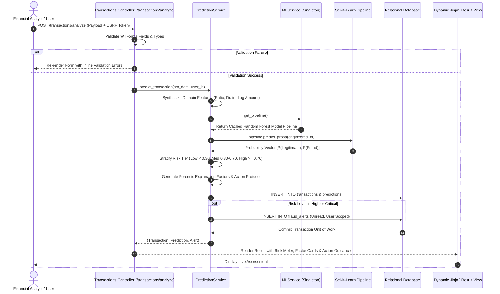
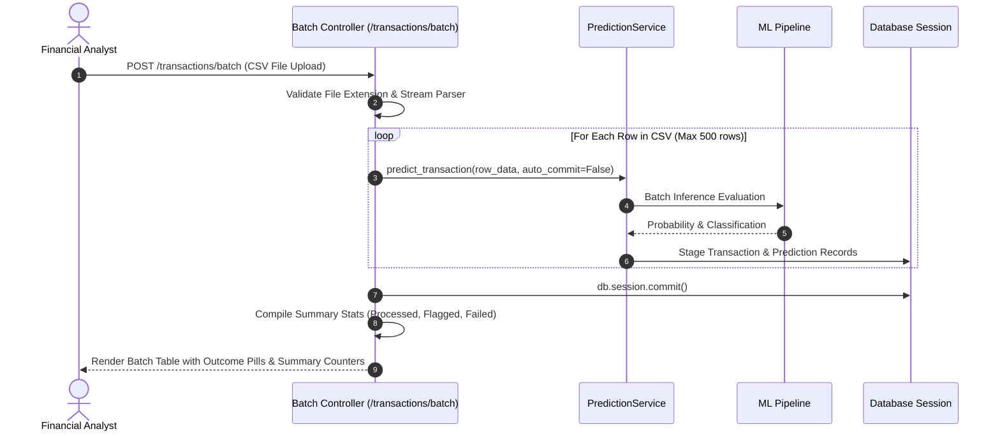

# FraudGuard AI: System Architecture & Data Flow

This document details the architectural design, software components, security topology, and end-to-end data pipelines powering FraudGuard AI.

---

## 1. High-Level Architectural Diagram

FraudGuard AI implements a multi-tier modular architecture adhering to separation-of-concerns principles:

```mermaid
flowchart TD
    subgraph Client Tier
        Browser["Modern Web Browser (Desktop / Mobile)"]
        APIClient["External Financial Core / REST Client"]
    end

    subgraph Presentation & Routing Tier (Flask Application Factory)
        ReverseProxy["WSGI Server (Waitress / Gunicorn)"]
        CSRF["CSRF Protection & Session Middleware"]
        AuthBP["Auth Blueprint (/auth)"]
        DashBP["Dashboard Blueprint (/)"]
        TxnBP["Transactions Blueprint (/transactions)"]
        AlertBP["Alerts Blueprint (/alerts)"]
        AnalyticsBP["Analytics Blueprint (/analytics)"]
        AdminBP["Admin Blueprint (/admin)"]
        ProfileBP["Profile Blueprint (/profile)"]
        APIBP["REST API Blueprint (/api/v1)"]
    end

    subgraph Service Tier (Business Logic)
        PredService["PredictionService (Pipeline Orchestrator)"]
        AnalyticsService["AnalyticsService (SQL Aggregator)"]
        MLService["MLService (Singleton Model Manager)"]
        AuditLogger["Audit Logger (Security Trail)"]
    end

    subgraph Machine Learning Tier
        JoblibArtifact["Persisted Random Forest Pipeline (pipeline.joblib)"]
        Preprocessor["Custom ColumnTransformer & Feature Synthesizer"]
        Metadata["Model Metadata & Feature Importance (JSON)"]
    end

    subgraph Persistence Tier
        DB[("Relational Database (SQLite / PostgreSQL)")]
        UserTbl["users Table"]
        TxnTbl["transactions Table"]
        PredTbl["predictions Table"]
        AlertTbl["fraud_alerts Table"]
        AuditTbl["audit_logs Table"]
    end

    Browser --> ReverseProxy
    APIClient --> ReverseProxy
    ReverseProxy --> CSRF
    CSRF --> AuthBP
    CSRF --> DashBP
    CSRF --> TxnBP
    CSRF --> AlertBP
    CSRF --> AnalyticsBP
    CSRF --> AdminBP
    CSRF --> ProfileBP
    CSRF --> APIBP

    TxnBP --> PredService
    APIBP --> PredService
    DashBP --> AnalyticsService
    AnalyticsBP --> AnalyticsService
    AdminBP --> AnalyticsService
    AdminBP --> MLService

    PredService --> MLService
    MLService --> JoblibArtifact
    MLService --> Preprocessor
    MLService --> Metadata

    PredService --> DB
    AnalyticsService --> DB
    AuditLogger --> DB

    DB --> UserTbl
    DB --> TxnTbl
    DB --> PredTbl
    DB --> AlertTbl
    DB --> AuditTbl
```

---

## 2. Sequence Diagram: Real-Time Transaction Prediction

The following sequence illustrates the life-cycle of a transaction evaluation request from form submission to risk gauge rendering and automated alert escalation:



---

## 3. Sequence Diagram: Batch CSV Processing Pipeline



---

## 4. Security Architecture & RBAC Matrix

FraudGuard AI enforces defense-in-depth principles:

### 4.1 Role-Based Access Control (RBAC)
- **Anonymous Visitors:** Can access Landing Page (`/`), Login (`/auth/login`), Registration (`/auth/register`), and System Health (`/api/health`). Protected routes redirect immediately to `/auth/login?next=<intended_url>`.
- **Authenticated Analysts / Users (`role='user'`):** Can access Dashboard, Transaction Analysis, Batch Evaluation, Transaction History (strictly scoped to transactions initiated by their user ID), Fraud Alerts, Analytics, and Profile Settings. Attempting to access administrative routes triggers an HTTP 403 Forbidden error and logs an immutable audit event.
- **System Administrators (`role='admin'`):** Inherits all Analyst permissions plus global visibility across all users' transactions, administrative User Management (activating/deactivating analyst accounts), System Security Audit Logs, and ML Model Telemetry & Diagnostics.

### 4.2 Security Controls Matrix
| Control | Implementation |
| :--- | :--- |
| **CSRF Defense** | Global `Flask-WTF` CSRF token injection on all forms; exempted only for decoupled REST API endpoints. |
| **Password Security** | Scrypt hashing with cryptographic salt via Werkzeug (`scrypt:32768:8:1`). Plaintext passwords are never stored or logged. |
| **Session Hardening** | `SESSION_COOKIE_HTTPONLY = True`, `SESSION_COOKIE_SAMESITE = 'Lax'`, permanent session lifetime of 7 days. |
| **Input Sanitization** | WTForms type casting, numeric range validators, string stripping, and SQL parameterization via SQLAlchemy ORM (zero string interpolation). |
| **Audit Logging** | Every authentication event, failed login, account deactivation, batch execution, and unauthorized admin access attempt is logged with IP address and timestamp. |
