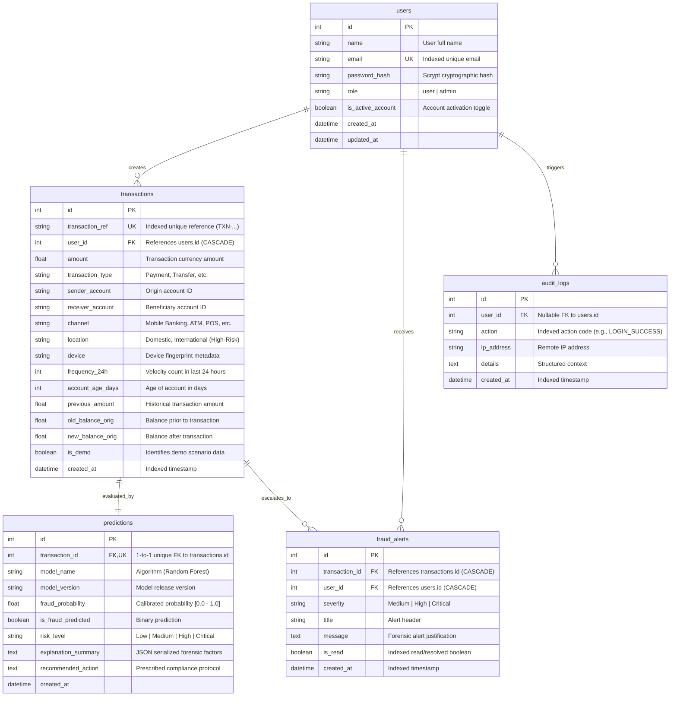

# FraudGuard AI: Database Design & Schema Specification

FraudGuard AI utilizes a fully normalized relational database schema managed via **SQLAlchemy ORM**. The data tier supports local file-based SQLite development and seamless migration to enterprise PostgreSQL in production.

---

## 1. Entity-Relationship Diagram (ERD)

---

## 2. Table Dictionaries & Schema Definitions

### 2.1 Table: `users`
Stores user identity, role-based authorization attributes, and cryptographic credentials.
| Column | Type | Constraints | Description |
| :--- | :--- | :--- | :--- |
| `id` | `INTEGER` | `PRIMARY KEY AUTOINCREMENT` | Unique surrogate key |
| `name` | `VARCHAR(100)` | `NOT NULL` | Full legal or display name |
| `email` | `VARCHAR(120)` | `NOT NULL, UNIQUE, INDEX` | Unique email identifier (lowercase normalized) |
| `password_hash` | `VARCHAR(255)` | `NOT NULL` | Salted Scrypt hash string |
| `role` | `VARCHAR(20)` | `NOT NULL, DEFAULT 'user'` | Access control role (`'user'` or `'admin'`) |
| `is_active_account` | `BOOLEAN` | `NOT NULL, DEFAULT TRUE` | Administrative killswitch for user access |
| `created_at` | `DATETIME` | `NOT NULL, DEFAULT utcnow` | Account creation timestamp |
| `updated_at` | `DATETIME` | `NOT NULL, DEFAULT utcnow` | Last profile update timestamp |

### 2.2 Table: `transactions`
Records financial transaction attributes, account metadata, and channel provenance.
| Column | Type | Constraints | Description |
| :--- | :--- | :--- | :--- |
| `id` | `INTEGER` | `PRIMARY KEY AUTOINCREMENT` | Unique transaction ID |
| `transaction_ref`| `VARCHAR(64)` | `NOT NULL, UNIQUE, INDEX` | Human-readable reference code (`TXN-...`) |
| `user_id` | `INTEGER` | `FOREIGN KEY (users.id) ON DELETE CASCADE, INDEX` | Associated analyst or customer ID |
| `amount` | `FLOAT` | `NOT NULL` | Transaction amount ($> 0.00$) |
| `transaction_type` | `VARCHAR(32)` | `NOT NULL` | Payment, Transfer, Cash Withdrawal, Deposit, Purchase |
| `sender_account`| `VARCHAR(64)` | `NOT NULL` | Originating bank account or wallet ID |
| `receiver_account`| `VARCHAR(64)` | `NOT NULL` | Beneficiary bank account or merchant ID |
| `channel` | `VARCHAR(32)` | `NOT NULL` | Mobile Banking, Internet Banking, ATM, POS, UPI |
| `location` | `VARCHAR(64)` | `NOT NULL, DEFAULT 'Domestic'` | Geographic risk profile |
| `device` | `VARCHAR(64)` | `NOT NULL` | Device fingerprint and trust classification |
| `frequency_24h`| `INTEGER` | `NOT NULL, DEFAULT 1` | Velocity count of transactions in last 24h |
| `account_age_days`| `INTEGER` | `NOT NULL, DEFAULT 365` | Age of origin account in days |
| `previous_amount`| `FLOAT` | `NOT NULL` | Historical transaction baseline amount |
| `old_balance_orig`| `FLOAT` | `NULLABLE` | Balance of sender prior to debit |
| `new_balance_orig`| `FLOAT` | `NULLABLE` | Balance of sender post debit |
| `is_demo` | `BOOLEAN` | `NOT NULL, DEFAULT FALSE` | Flag for seeded portfolio demo records |
| `created_at` | `DATETIME` | `NOT NULL, DEFAULT utcnow, INDEX`| Creation timestamp |

### 2.3 Table: `predictions`
Stores model inferences, calibrated probabilities, risk tiers, and explainability factors.
| Column | Type | Constraints | Description |
| :--- | :--- | :--- | :--- |
| `id` | `INTEGER` | `PRIMARY KEY AUTOINCREMENT` | Unique prediction ID |
| `transaction_id`| `INTEGER` | `FOREIGN KEY (transactions.id) ON DELETE CASCADE, UNIQUE` | 1-to-1 relationship with transaction |
| `model_name` | `VARCHAR(64)` | `NOT NULL` | Name of model (e.g. `Random Forest`) |
| `model_version` | `VARCHAR(32)` | `NOT NULL, DEFAULT '1.0.0'` | Model version identifier |
| `fraud_probability`| `FLOAT` | `NOT NULL` | Calibrated continuous score $[0.0, 1.0]$ |
| `is_fraud_predicted`| `BOOLEAN` | `NOT NULL` | Binary decision threshold |
| `risk_level` | `VARCHAR(20)` | `NOT NULL` | Stratified tier (`Low`, `Medium`, `High`, `Critical`) |
| `explanation_summary`| `TEXT` | `NULLABLE` | JSON array of forensic justification strings |
| `recommended_action`| `TEXT` | `NULLABLE` | Operational compliance guidance |
| `created_at` | `DATETIME` | `NOT NULL, DEFAULT utcnow` | Prediction timestamp |

### 2.4 Table: `fraud_alerts`
Tracks actionable security alerts triggered by High or Critical risk inferences.
| Column | Type | Constraints | Description |
| :--- | :--- | :--- | :--- |
| `id` | `INTEGER` | `PRIMARY KEY AUTOINCREMENT` | Unique alert ID |
| `transaction_id`| `INTEGER` | `FOREIGN KEY (transactions.id) ON DELETE CASCADE, INDEX` | Linked high-risk transaction |
| `user_id` | `INTEGER` | `FOREIGN KEY (users.id) ON DELETE CASCADE, INDEX` | Owner of transaction |
| `severity` | `VARCHAR(20)` | `NOT NULL` | `Medium`, `High`, or `Critical` |
| `title` | `VARCHAR(128)`| `NOT NULL` | Alert title |
| `message` | `TEXT` | `NOT NULL` | Forensic justification details |
| `is_read` | `BOOLEAN` | `NOT NULL, DEFAULT FALSE, INDEX` | Status flag (`False` = unread/active) |
| `created_at` | `DATETIME` | `NOT NULL, DEFAULT utcnow, INDEX`| Alert creation timestamp |

### 2.5 Table: `audit_logs`
Provides an immutable security trail for administrative and compliance auditing.
| Column | Type | Constraints | Description |
| :--- | :--- | :--- | :--- |
| `id` | `INTEGER` | `PRIMARY KEY AUTOINCREMENT` | Unique log entry ID |
| `user_id` | `INTEGER` | `FOREIGN KEY (users.id), NULLABLE, INDEX` | Actor user ID (null for anonymous attempts) |
| `action` | `VARCHAR(64)` | `NOT NULL, INDEX` | Action code (`LOGIN_SUCCESS`, `ALERT_READ`, etc.) |
| `ip_address` | `VARCHAR(45)` | `NOT NULL, DEFAULT '127.0.0.1'` | Client IP address (IPv4 or IPv6) |
| `details` | `TEXT` | `NULLABLE` | Contextual metadata |
| `created_at` | `DATETIME` | `NOT NULL, DEFAULT utcnow, INDEX`| Event timestamp |

---

## 3. Database Indexes & Query Optimization

To guarantee sub-10ms response times for high-volume dashboard queries and transaction filtering:
1. `users.email`: Unique B-Tree index for $O(1)$ authentication lookups.
2. `transactions.transaction_ref`: Unique B-Tree index for quick reference searches.
3. `transactions.created_at`: Descending index for rapid pagination of newest records.
4. `transactions.user_id`: Foreign key index to enforce multi-tenant customer isolation without full-table scans.
5. `fraud_alerts.is_read` & `fraud_alerts.user_id`: Composite index powering instantaneous unread alert count badge queries (`inject_global_data` context processor).
6. `audit_logs.action` & `audit_logs.created_at`: Filtered administrative index for audit inspection.
