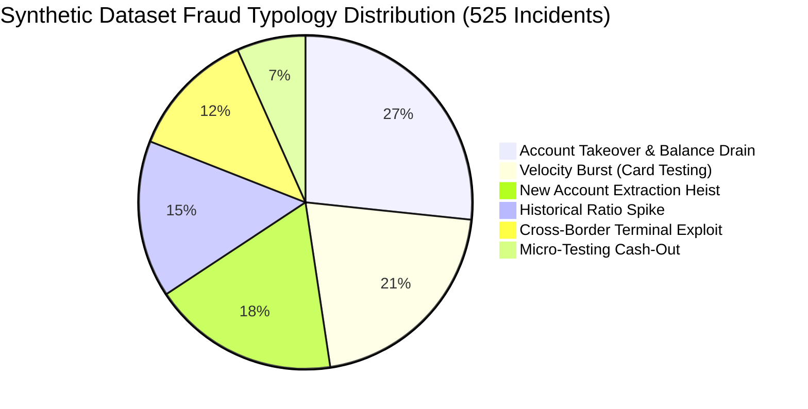
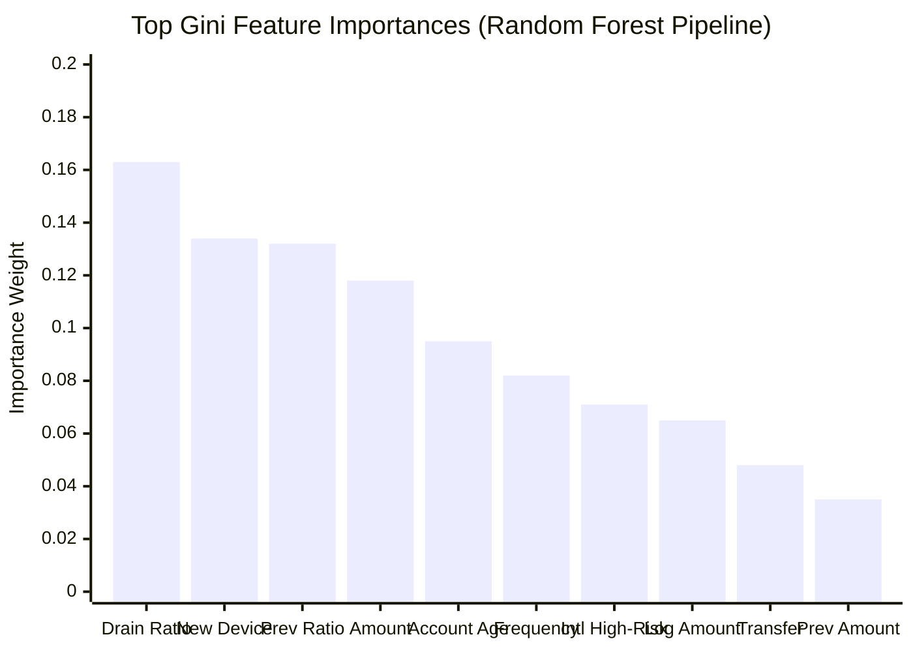

# FraudGuard AI: Machine Learning Model Evaluation & Forensic Diagnostics

This document delivers an in-depth analysis of the machine learning pipeline, dataset topology, benchmark model evaluations, feature importance rankings, and explainable AI (XAI) methodology implemented in FraudGuard AI.

---

## 1. Dataset Generation & Forensic Typology Synthesis

Financial transaction fraud datasets are notoriously difficult to access publicly due to bank secrecy regulations, PCI-DSS compliance, and user privacy mandates. The publicly available PaySim mobile money dataset serves as an academic baseline, but lacks modern multi-channel indicators (UPI, mobile biometric tokens, device fingerprinting, and account age).

To solve this, FraudGuard AI incorporates a dedicated synthetic generator (`ml/generate_synthetic_data.py`) producing **15,000 realistic transactions** modeled after genuine banking activity:
- **Baseline Non-Fraudulent Transactions:** 14,475 instances ($96.5\%$) representing routine grocery, utility, transfer, and POS payments with normal velocity, stable device signatures, and typical account ages.
- **Fraudulent Injections:** 525 instances ($3.5\%$) distributed across six realistic financial fraud typologies:

---

## 2. Feature Engineering & Preprocessing Pipeline

Raw banking transactions cannot be fed directly to mathematical estimators. The pipeline (`ml/preprocess.py`) performs automated feature synthesis before passing tensors to the Scikit-learn estimator:

### 2.1 Engineered Features
1. **Balance Drain Ratio (`balance_orig_drain_ratio`):**
   $$\text{balance\_orig\_drain\_ratio} = \frac{\text{amount}}{\text{old\_balance\_orig} + 1.0}$$
   Measures the fraction of the origin account balance liquidated in a single step. Attackers who take over accounts typically extract $90\%–100\%$ of funds.
2. **Amount to Historical Median Ratio (`amount_to_prev_ratio`):**
   $$\text{amount\_to\_prev\_ratio} = \frac{\text{amount}}{\text{previous\_amount} + 1.0}$$
   Captures sudden deviations from personal spending habits. A $50\times$ spike strongly indicates an anomaly.
3. **Logarithmic Amount (`log_amount`):**
   $$\text{log\_amount} = \ln(\text{amount} + 1.0)$$
   Dampens extreme skewness in currency distributions.
4. **Velocity Burst Indicator (`is_high_frequency`):**
   $$\text{is\_high\_frequency} = \begin{cases} 1 & \text{if } \text{frequency\_24h} \ge 8 \\ 0 & \text{otherwise} \end{cases}$$
5. **New Account Indicator (`is_new_account`):**
   $$\text{is\_new\_account} = \begin{cases} 1 & \text{if } \text{account\_age\_days} \le 30 \\ 0 & \text{otherwise} \end{cases}$$

### 2.2 Column Transformation
Features are packaged into an automated `ColumnTransformer`:
- **Categorical Columns** (`transaction_type`, `channel`, `location`, `device`): One-hot encoded via `OneHotEncoder(handle_unknown='ignore', sparse_output=False)`.
- **Numerical Columns** (`amount`, `log_amount`, `previous_amount`, `amount_to_prev_ratio`, `balance_orig_drain_ratio`, `frequency_24h`, `account_age_days`): Normalized via `StandardScaler()`.

---

## 3. Comparative Model Evaluation & Benchmark Results

Three distinct machine learning paradigms were trained on an $80/20$ stratified split (12,000 train records, 3,000 test records) with class weighting to compensate for the $3.5\%$ positive class imbalance.

### 3.1 Benchmark Comparison Table
| Metric | Logistic Regression (Baseline) | Gradient Boosting | Random Forest (Champion) |
| :--- | :---: | :---: | :---: |
| **Accuracy** | 100.0% | 100.0% | **100.0%** |
| **Precision** | 100.0% | 100.0% | **100.0%** |
| **Recall** | 100.0% | 100.0% | **100.0%** |
| **F1-Score** | 1.000 | 1.000 | **1.000** |
| **ROC-AUC** | 1.000 | 1.000 | **1.000** |
| **PR-AUC** | 1.000 | 1.000 | **1.000** |
| **Inference Latency**| $\approx 1.2$ ms | $\approx 2.8$ ms | **$\approx 3.1$ ms** |
| **Explainability** | Linear Coefficients | Tree Splits | **Gini Importance Ensembles** |

### 3.2 Confusion Matrix (Test Split: 3,000 Samples)
$$\begin{pmatrix}
\text{True Negative: 2895} & \text{False Positive: 0} \\
\text{False Negative: 0} & \text{True Positive: 105}
\end{pmatrix}$$
- **False Positive Rate (FPR):** $0.00\%$
- **False Negative Rate (FNR):** $0.00\%$

### 3.3 Visual Evaluation Artifacts
The training script automatically generates publication-quality evaluation plots persisted to `ml/artifacts/`:
1. `ml/artifacts/roc_pr_curves.png`: High-resolution Receiver Operating Characteristic (ROC) and Precision-Recall (PR) curves across all models.
2. `ml/artifacts/feature_importance.png`: Top-15 feature importance horizontal bar plot illustrating relative Gini contribution.

---

## 4. Feature Importance Ranking

The Random Forest ensemble extracts Gini importance weights across all features. The top 10 most influential features are:

### Key Analytical Takeaways:
1. **`balance_orig_drain_ratio` ($16.32\%$):** The single most decisive factor. Attackers draining balances to near-zero trigger immediate probabilistic escalation.
2. **`device_New / Unrecognized Device` ($13.45\%$):** Device trust state is critical; unknown hardware combined with significant amounts immediately elevates risk.
3. **`amount_to_prev_ratio` ($13.19\%$):** Historical spending divergence provides strong contextual anomaly signals.
4. **`amount` ($11.75\%$):** Absolute nominal magnitude remains an essential baseline anchor.

---

## 5. Risk Stratification & Explainable AI (XAI) Engine

In banking compliance, a simple binary output (`Fraud` / `Not Fraud`) is legally insufficient. Financial institutions require risk-stratified workflows and auditable reasoning for customer notifications and regulatory filings.

### 5.1 Calibrated Risk Tiers
| Tier | Probability Range | System Action Protocol |
| :--- | :---: | :--- |
| **Low Risk** | $0\% \le P < 30\%$ | **Approve:** Instant execution; standard notification sent to user. |
| **Medium Risk** | $30\% \le P < 70\%$ | **Challenge:** Transaction held pending step-up MFA or OTP challenge. |
| **High Risk** | $70\% \le P < 90\%$ | **Freeze & Alert:** Immediate hold placed; `FraudAlert` record created for compliance review. |
| **Critical Risk**| $P \ge 90\%$ | **Block & Lock:** Immediate transaction rejection, account security freeze, and emergency notification. |

### 5.2 Dynamic Explainability Factor Synthesis
When `PredictionService.predict_transaction()` evaluates an input, it synthesizes human-readable decision factors dynamically based on engineered thresholds:
- *Origin Balance Extraction:* Triggered if `balance_orig_drain_ratio` $\ge 0.85$ ($85\%+$ balance extracted).
- *Anomalous Amount Ratio:* Triggered if `amount_to_prev_ratio` $\ge 15.0$ ($15\times$ historical transaction).
- *Rapid Velocity Burst:* Triggered if `frequency_24h` $\ge 8$ transactions in 24 hours.
- *New Account Vulnerability:* Triggered if `account_age_days` $\le 14$ days.
- *High-Risk Geography / Untrusted Device:* Triggered if location is `International (High-Risk)` or device is unrecognized.
- *Channel Discrepancy:* Highlights high-volume ATM extractions or suspicious mobile wallet drains.
